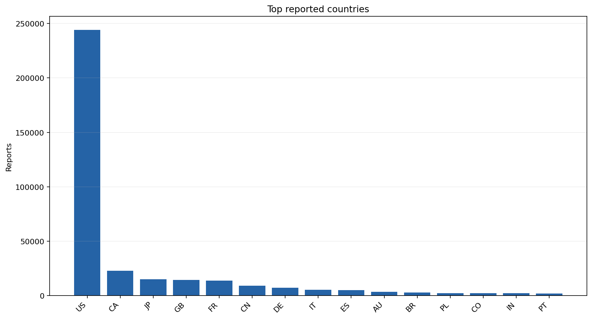
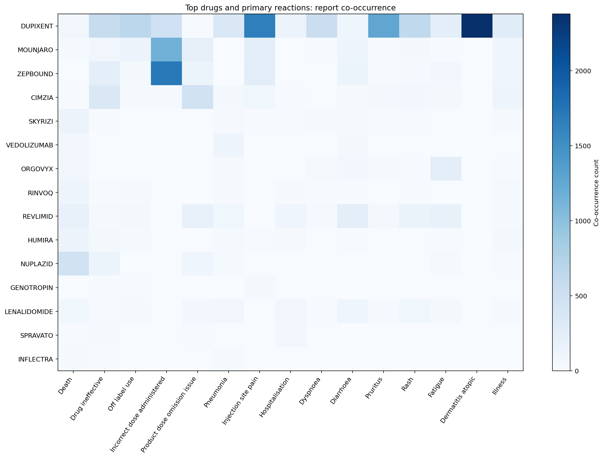
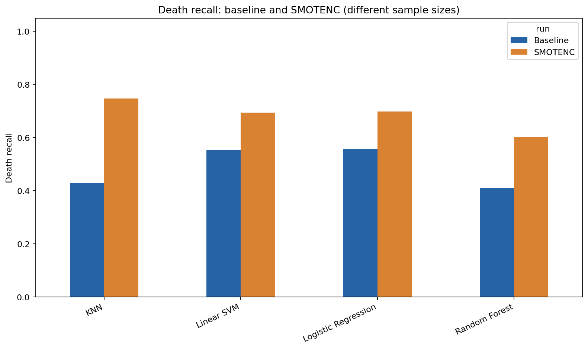

# Patient Drug Event Analysis

Analyze a merged adverse drug-event CSV and classify whether a report has a known death outcome. This project provides inspection, cleaning, exploratory plots, four classifiers, a separate SMOTENC experiment, saved models, and reproducible result files.

The project was rebuilt from the supplied study guide. Measured results are in [RESULTS.md](RESULTS.md); historical classroom and guide metrics are kept separately in [presentation/README.md](presentation/README.md). The raw CSV is a user-supplied merged dataset; this project does not claim to have downloaded or verified individual records against OpenFDA.

## Start here on Windows

The local environment and outputs have already been generated in this folder. Run from this folder in PowerShell:

```powershell
.\.venv\Scripts\python.exe -m src.project all
```

To set up another machine with Python 3.10 or later:

```powershell
python -m venv .venv
.\.venv\Scripts\python.exe -m pip install -r requirements.txt
# Put the source CSV at data/raw/2025_merged.csv, then:
.\.venv\Scripts\python.exe -m src.project all
```

For Linux/macOS use `.venv/bin/python` instead. You can pass `--data /path/to/your.csv` to every data-processing command. The real dataset stays local and is excluded from Git. A 200-row real sample is included for understanding the schema; it is too small for meaningful model evaluation.

## Google Colab

Upload `notebooks/Patient_Drug_Event_Analysis_Colab.ipynb` to Colab and run cells in order. The notebook embeds the source code, installs pinned packages, asks for the real CSV, performs the analysis, displays results and selected plots, and downloads an archive of outputs. It does not require a GitHub URL or a clone of this repository. Restart the Colab runtime after installing if it asks you to.

## Workflow

1. Inspect the 14 required source fields and missingness.
2. Strip text, remove accidental CSV index columns, filter weight to `(0, 650]`, parse dates and derive calendar fields.
3. Map the merged course dataset's seriousness codes: `1 -> 1`, `2 -> 0`, other or missing -> unknown. This assumption belongs to this merged schema; it is not a universal OpenFDA code interpretation.
4. Keep unknown outcomes for EDA and exclude them from supervised training.
5. Use a stratified 65,000-row baseline sample and a 15,000-row SMOTENC sample, with a separate 80/20 split in each run and seed 42.
6. Learn rare categories (frequency below 25), numeric medians, scaling and one-hot encoding on training rows only.
7. Train Logistic Regression, Random Forest, Linear SVM and KNN; include a majority-class dummy reference.
8. Resample only the SMOTENC training partition after standardizing continuous fields, then evaluate on its original test partition.
9. Save metrics, predictions, confusion matrices, comparisons, provenance and model artifacts.

Baseline and SMOTENC use different samples to follow the guide. For a controlled comparison use matching sample sizes, which produces identical source splits:

```powershell
.\.venv\Scripts\python.exe -m src.project all --baseline-sample 15000 --smotenc-sample 15000
```

Smaller smoke run: use both sample sizes set to 1000. Results files are replaced when rerunning; preserve an output folder first if you need multiple experiments.

## Files

| Location | Contents |
| --- | --- |
| `src/project.py` | Shared pipeline and command line |
| `src/01_inspect_dataset.py` through `07_build_github_outputs.py` | Individual guide steps |
| `src/predict.py` | Inference using a saved model |
| `notebooks/Patient_Drug_Event_Analysis_Colab.ipynb` | Standalone Colab workflow |
| `data/raw/` and `data/processed/` | Local full datasets, ignored by Git |
| `data/sample_patient_drug_events.csv` | 200 real source rows |
| `outputs/results/` | Metrics, per-class reports, row splits, predictions and summaries |
| `outputs/plots/` | EDA, confusion matrices and comparisons |
| `models/` | Eight local model bundles, ignored by Git |
| `tests/` | Data validation, leakage, split, resampling and model persistence checks |
| `requirements-lock.txt` | Exact installed environment |

Run individual steps, for example:

```powershell
.\.venv\Scripts\python.exe src/01_inspect_dataset.py
.\.venv\Scripts\python.exe src/02_clean_data.py
.\.venv\Scripts\python.exe src/03_eda.py
.\.venv\Scripts\python.exe src/04_train_baseline_models.py
.\.venv\Scripts\python.exe src/05_train_with_smotenc.py
.\.venv\Scripts\python.exe src/07_build_github_outputs.py
.\.venv\Scripts\python.exe -m unittest discover -s tests -v
```

Predict with a trusted model:

```powershell
.\.venv\Scripts\python.exe -m src.predict --model models/baseline_logistic_regression.joblib --data data/sample_patient_drug_events.csv
```

Scores are model outputs, not validated mortality probabilities. SMOTENC changes training prevalence, and SVM scores are margins.

## Selected outputs





## Optional scalability experiment

The main run does not generate a 1 GB file. Explicitly run this if needed:

```powershell
.\.venv\Scripts\python.exe src/06_generate_synthetic_data.py --synthetic-bytes 1000000000
```

This bootstraps whole source rows and adds small noise only to valid weight values. It preserves codes and dates, writes in chunks, records provenance, and refuses to append to an existing output. The final file can exceed the target by one chunk. It is a stress-test artifact, not additional real evidence. A small validation run has been tested locally.

## Interpretation

This is educational retrospective report classification. Reactions can describe an already-observed outcome. Reporting bias, unknown outcomes and repeated reports limit interpretation. There is no report identifier in this merged CSV, so random row splitting cannot ensure patient/report independence. Counts are not drug risk rates and do not establish causation. Outcome labels for hospitalization, disability and death are excluded from predictors. Read the detailed limits in RESULTS.md before interpreting scores.

## GitHub preparation

The project is ready to review locally. `.gitignore` excludes the source, cleaned and synthetic full data, environments and model binaries. The matching original classroom slide deck is included under `presentation/`; see `presentation/README.md` for its verified title and authors.

```powershell
git status --short
git add .
git status --short
git commit -m "Build patient drug event analysis"
git remote add origin https://github.com/YOUR-USERNAME/patient-drug-event-analysis.git
git push -u origin HEAD
```

Check staged files before publishing, including whether you want to publish the real 200-row sample. No remote repository or push is required for running the project.

Implementation references: [scikit-learn preprocessing](https://scikit-learn.org/stable/modules/preprocessing.html) and [imbalanced-learn mixed-data oversampling](https://imbalanced-learn.org/stable/over_sampling.html).
